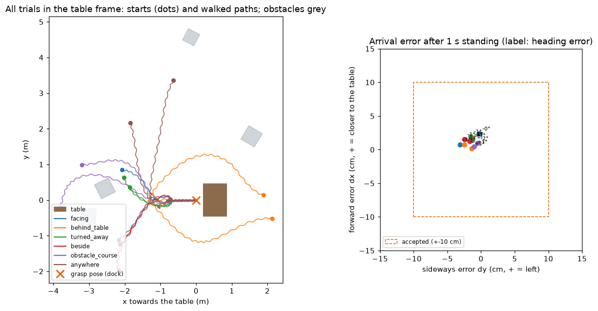

# Saad's work (2026-10-08 – 2026-10-09)

Branch `saad/table-distractors`. Everything here runs in **simulation** (MuJoCo + LeRobot G1 sim with the GR00T walking
controller). Nothing has run on the real robot yet.

The code is **not in this folder** on purpose: it lives where the rest of the project expects it (`g1sim/`, `scripts/`,
`tests/`), because several of the files are shared with the team's code. This page explains what was built, the results,
how to run it, and lists every file that was created or changed. The full log is in `PROGRESS.md` (entries from 2026-10-08 on).

## 1. Distractors on the volleyball table

**Why:** if the ball is the only thing on the table, a VLA can learn "grab whatever is there" or "grab the red thing". Real
tables have other things on them.

- 5 distractors in the volleyball scene: cardboard box, drink can, **red cylinder** (same red as the ball, on purpose: the
  model has to use shape, not only colour), purple cylinder, yellow block.
- 1–3 of them per trial, placed only where the scripted teacher cannot hit them (clear of ball, basket and the carry arc).
  Unused ones are parked out of sight.
- Touching a distractor counts as a failed demo.
- **Result:** 30/30 trials with distractors, nothing touched, no distractor moved.

## 2. Full randomization in the volleyball scene

**Why:** variety in the demos forces a VLA to look at the camera image instead of memorizing one movement.

- `reset(randomize=True)` now varies everything in the volleyball scene, not only the distractors: ball + stand position
  (±10 cm), the robot's stand pose (±10 cm, ±10°), physics (mass, friction, motor gains, delay), image (light, table colour,
  ball colour, camera pose, noise).
- The ball teacher now follows the robot's **real** stand pose (it used to assume fixed waist angles).
- **Reach rule:** each random group alone passed 20/20, but together only 85/100 – a shifted stand plus a shifted ball put the
  ball out of reach. Starts with the ball outside 0.33–0.52 m from the pelvis are now redrawn.
- **Result:** 100/100 fully randomized trials (seeds 0 and 1). The bottle scene is unchanged (checked bit-exact).

## 3. Walking up to the table from random start situations

**Why:** the robot will not start at the table – it has to walk there and arrive precisely enough for the grasp.

Each trial puts the table (and 0–3 obstacles) at a random spot around the robot, in six situations:

| Situation | What the robot has to do |
|---|---|
| `facing` | table ahead |
| `behind_table` | robot stands behind the table: walk all the way round |
| `turned_away` | table behind the robot: turn round first |
| `beside` | table to the left or right |
| `obstacle_course` | 1–3 obstacles between robot and table |
| `anywhere` | random direction, distance and orientation |

How a trial runs (the checkpoint sequence, 2026-10-09):

1. **Plan** a path round table and obstacles (A*), pull it taut, round the corners, end with a straight lead-in onto the line
   into the table.
2. **Walk** with the arms down and a **slight natural arm swing** (each arm opposite to its leg, ±2.5–5°, slow and smooth),
   following the path calmly (speed profile + pure pursuit).
3. **Checkpoint** ~3–4 steps (0.75 m) before the table: line up on the line into the table, facing it.
4. **Raise the arms** to the grasp start pose while standing (they must not swing into the table).
5. **Walk straight in** – forward steps only, no side steps (no "penguin walk" with the body turned away).
6. Stand 1 s and measure. Pass = no fall, no contact, within ±10 cm / ±10° of the grasp pose (what the ball teacher handles).



*All 12 trials of the last run in the table frame: different starts, every path ends in the same straight line into the
table. Right: arrival errors, all within ~3 cm.*

**Results:**

| Version | Trials | Arrival error (max) | Notes |
|---|---|---|---|
| First version (side-stepping dock) | 24/24 + 24/24 + 12/12 | ≤ 3.4 cm, ≤ 3.3° | body up to **87°** turned away from the table while docking |
| Calm path following | 12/12 | ≤ 3 cm | path deviation 9.5 → **4.4 cm** |
| Checkpoint + straight walk-in | 12/12 + 12/12 | ≤ 4.0 cm, ≤ 2.9° | body ≤ **4°** off the table axis, **no** side steps |
| + arm swing | 12/12 | ≤ 3.2 cm, ≤ 3.0° | swing ≤ 6°, 0 arm–leg contacts |

**Honest limits:**
- The robot's position comes from the simulator. The real robot will use BotBrain/Nav2 for this, which is less precise.
- Path deviation while walking is 7 cm on average with the arms down (4.1 cm with the arms up) – the checkpoint corrects it.
- One table size, flat open floor.
- **Not done yet:** grasping after the walk. See "Next" below.

### Bugs found and fixed on the way
- Live view crashed (bus error): a drawing function used uninitialized memory – also in the older walking scripts.
- With the arms in the default pose, the fingertips hit the table top (the walking robot stands ~5 cm lower).
- The robot stopped 5 cm short: GR00T barely moves at very slow commands (measured, then compensated).
- Watching the run slowed the control loop from 20 to 8 Hz and the robot started to overshoot – the controller now uses sim time.
- GR00T drifts ~35 cm sideways when it turns 180° on the spot – the robot now steps back while turning.

## How to run

Environment: `~/dev/g1-ext/.venv` (set up on 2026-10-08; see `COMMANDS.md`).

```bash
# Lab view (optional, http://127.0.0.1:8030)
~/dev/g1-ext/.venv/bin/python scripts/65_labview.py

# Volleyball pick and place, fully randomized (with distractors)
~/dev/g1-ext/.venv/bin/python scripts/67_volleyball_pick_place.py --trials 50 --randomize --seed 0

# Walk up to the table, live at http://127.0.0.1:8020 (camera + top view)
DYLD_LIBRARY_PATH=$HOME/dev/g1-ext/cyclonedds/install/lib PYTHONUNBUFFERED=1 \
  ~/dev/g1-ext/.venv/bin/python scripts/68_walk_to_table.py --trials 12 --seed 0
#   --scenarios behind_table,turned_away   only some situations
#   --walk-arms up / --no-swing / --follower grid   comparisons
```

## Files

**New:**

| File | What |
|---|---|
| `g1sim/approach.py` | scenarios, checkpoint and lead-in geometry, path planning, docking and straight walk-in controllers |
| `g1sim/approach_world.py` | walking scene with a movable table (top + 4 legs) and obstacles, contact report |
| `g1sim/arm_swing.py` | natural arm swing from the foot positions |
| `scripts/68_walk_to_table.py` | the walk-to-table run: live view, lab view, results, plot |
| `tests/test_integration_distractors.py` | distractor placement, parking, replay |
| `tests/test_unit_approach.py` | geometry, scenarios, checkpoint, docking, straight walk-in |
| `tests/test_integration_approach_world.py` | table shape, moving furniture, contacts, live-view marker crash |
| `tests/test_unit_smooth_path.py` | path smoothing, speed profile, path follower |
| `tests/test_unit_arm_swing.py` | arm swing direction, size, speed |

**Changed (shared with the team's code):**

| File | Change |
|---|---|
| `g1sim/table_scene.py` | distractors in the volleyball scene, reach rule |
| `g1sim/randomization.py` | distractor sampling, every group works in every scene, per-scene ranges |
| `configs/randomization.json` | distractor group, volleyball ranges |
| `g1sim/table_env.py` | parks/places distractors, redraws starts out of reach |
| `g1sim/ball_grasp.py` | distractors are forbidden contacts, teacher follows the real stand pose |
| `scripts/67_volleyball_pick_place.py` | `--distractors`, `--randomize`, `--vary` |
| `g1sim/navigation.py` | smooth path follower with speed profile |
| `g1sim/occupancy.py` | path shortcut + smoothing |
| `g1sim/walk_sim.py` | arm targets while walking, foot gap, arm–leg contacts, top view |
| `g1sim/liveview.py` | top-view map, marker crash fix |
| `g1sim/labview.py` | walking phases and failure reasons, reuse of the live image |
| `tests/test_integration_volleyball_*.py`, `tests/test_unit_labview.py` | updated and new tests |
| `PLAN.md`, `PROGRESS.md`, `COMMANDS.md`, `docs/LEARNING_PATH.md`, `docs/START_PROMPT.md` | plan, log, commands, explanations (§10.31–10.40) |

## Next

Merge walking and pick and place, in stages (details in `docs/LEARNING_PATH.md` §10.40):

0. **Waist test** – in the walking sim GR00T controls the waist, but the ball teacher turns it ±35°. Test whether overriding it
   keeps the robot balanced (and raise the robot to grasp height).
1. Ball, stand and basket on the walking table; walk still 12/12.
2. Walk + grasp on the free-standing robot: ≥ 8/10 ball in the basket.
3. Distractors and full randomization in the combined world.
4. Record walk + grasp demos for the VLA.
